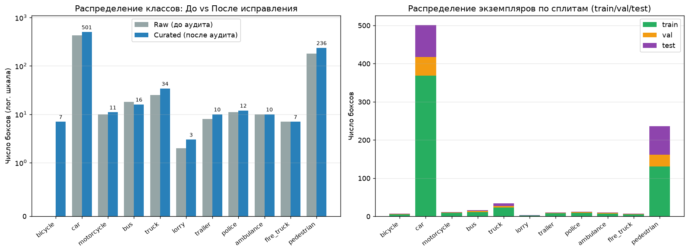
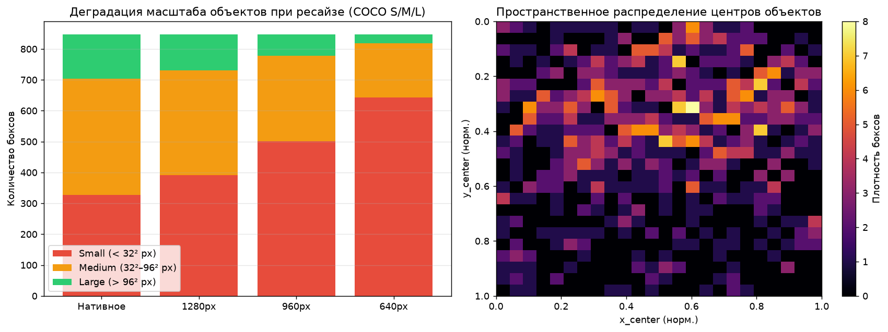
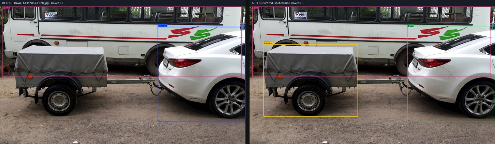
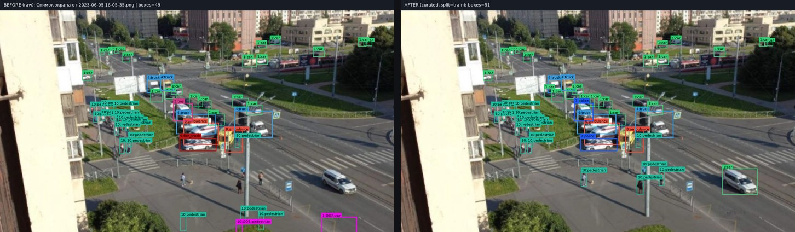
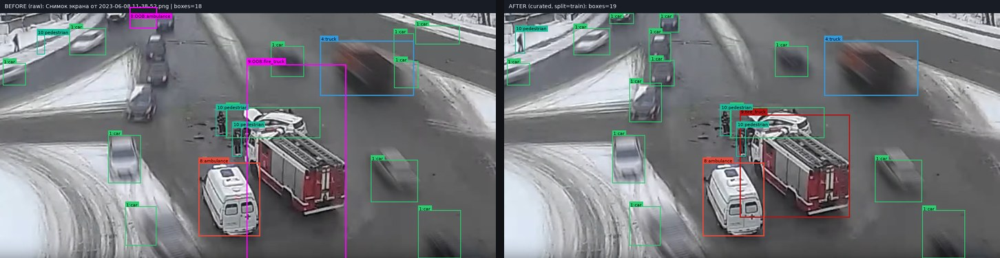

# STS CV Test: Детекция участников дорожного движения (Ultralytics YOLO + TensorBoard)

Воспроизводимый инженерный пайплайн подготовки данных, строгого аудита разметки и экспериментов детекции объектов на базе **Ultralytics YOLO** с локальным логированием в **TensorBoard** (`torch.utils.tensorboard.SummaryWriter`).

---

## 1. Ключевые особенности решения

- **Неизменяемость исходных данных**: предоставленная мини-выборка `test_data/traffic_v5_mini/` сохранена побайтово без изменений. Все проверенные правки и доразметка вынесены в версионируемый текстовый слой `data/curated/labels/` с машиночитаемым журналом `data/curated/audit_changelog.json`.
- **Глубокий аудит 100% изображений (40 из 40)**:
  - автоматически выявлены 16 формальных ошибок (`10` отсутствующих `.txt`, `4` выхода границ за `[0, 1]`, `2` неизвестных `class_id=11`);
  - сплошной визуальный и кросс-детекторный аудит выявил скрытые семантические дефекты: смещение 5 боксов вниз на `Δy ≈ +0.20` (`2023-06-05 16-05-35`), перепутанные классы (`police` вместо `car` и пропущенный `trailer` в `4d3c2d6s-1920`, `bus` вместо `car` в `2023-06-07 16-42-06`, `fire_truck`/`bus` вместо `police`), фантомные и растянутые боксы (`2023-06-08 11-38-52`), неполную разметку (`2023-06-07 14-48-31`);
  - доразмечены все 10 отсутствующих файлов (включая все 7 экземпляров класса `0: bicycle`, которого было `0` в исходных `.txt`). Итог: **847 валидных боксов, 11/11 классов, 0 ошибок, 0 предупреждений**.
- **Защита от Data Leakage между сплитами**: выделено `28` независимых групп сцен (включая `6` мультикадровых стационарных камер — с объединением дневных/ночных и зимних/летних кадров одной камеры). Все кадры одной камеры попадают строго в один сплит (`0%` утечки) при максимизации покрытия редких классов (`11/11` классов в `train` и `test`, `10/11` в `val`).
- **Анализ масштабов объектов (STS-специфика)**: EDA показал, что при ресайзе до `imgsz=640` доля малых объектов (`< 32² px`) возрастает с `38.6%` до `75.9%` (`58.6%` микро-боксов `< 16 px`). На основе этой гипотезы в экспериментах сравниваются `yolo11n @ 640` и `yolo11s @ 960`.
- **Чистое воспроизводимое логирование в TensorBoard**: изолированная папка на каждый запуск в `runs/`, фиксация Git SHA + SHA-256 `dataset.yaml` и `manifest.sha256`, полные кривые `loss`/`metrics`/`lr`, поклассовые `AP@0.5`, confusion matrix, PR/F1-кривые подбора порога уверенности, визуальный Error Analysis (`TP/FP/FN` для худших кадров), оценка на независимом `test` и замер скорости инференса (`Latency / FPS`).
- **Автоматическая проверка в GitHub Actions**: [`.github/workflows/ci.yml`](.github/workflows/ci.yml) на каждом push прогоняет `ruff`, `pytest`, воспроизводимую сборку датасета, строгую валидацию разметки, проверку `manifest.sha256` и отсутствие абсолютных путей.

### Визуальные примеры аудита данных

| Распределение классов (До → После и по сплитам) | Масштабы объектов (COCO S/M/L) и карта центров |
|---|---|
|  |  |

**Пример исправления скрытых дефектов (`4d3c2d6s-1920.jpg` — неверный класс `police → car` и пропущенный `trailer`):**


**Пример исправления смещённых боксов (`Δy ≈ +0.20`, выход за `y > 1.0`) и перепутанных классов ДПС (`2023-06-05 16-05-35.png`):**


**Пример исправления растянутого бокса `fire_truck (y2=1.09)`, фантомных боксов и 5 пропущенных авто (`2023-06-08 11-38-52.png`):**


---

## 2. Структура репозитория

```text
sts-cv-test/
├── README.md
├── requirements.txt
├── pyproject.toml
├── .gitignore
├── test_data/
│   └── traffic_v5_mini/         # Неизменяемый исходник мини-выборки (включён в Git)
│       ├── README.md
│       ├── classes.txt
│       ├── images/
│       └── labels/
├── configs/
│   └── yolo.yaml                # YAML-конфигурация эксперимента
├── src/
│   ├── __init__.py
│   ├── prepare_dataset.py       # Аудит, доразметка, group-split, отчёт, сэмплы, manifest
│   ├── validate_labels.py       # Валидатор изображений, EXIF, YOLO-боксов и ID классов CVAT
│   ├── tensorboard_logger.py    # SummaryWriter, коллбэки Ultralytics, Error Analysis
│   ├── run_experiment.py        # CLI-раннер (--dry-run и обучение/оценка/бенчмарк)
│   └── utils.py                 # Seed, SHA-256 manifest, Git-метаданные, Unicode-safe I/O
├── data/
│   ├── README.md                # Таксономия 11 классов и стратегия расширения датасета
│   ├── curated/                 # Верифицированные .txt аннотации + audit_changelog.json
│   ├── raw/
│   │   └── .gitkeep             # Место для внешних батчей (--extra-input, вне Git)
│   └── processed/
│       └── .gitkeep             # Генерируется prepare_dataset.py (вне Git)
├── reports/
│   ├── dataset_report.md        # Полный отчёт по данным (До → После, камеры, S/M/L)
│   ├── manifest.sha256          # SHA-256 контрольные суммы всех файлов выборки
│   └── samples/                 # Оверлеи с bbox, коллажи «Было → Стало», графики EDA
├── runs/
│   └── .gitkeep                 # Изолированные запуски с логами TensorBoard (вне Git)
└── tests/
    ├── test_labels.py           # Тесты валидатора (координаты, классы, битые файлы, кириллица)
    └── test_dataset_split.py    # Тесты сплита (детерминизм, 0% утечки камер, manifest)
```

---

## 3. Установка из чистого окружения

Рекомендуется **Python 3.12** (протестировано на `Python 3.12.16`, `torch 2.15.0`, `ultralytics 8.4.218`, `tensorboard 2.21.0`).

### Вариант 1: через `uv` (рекомендуется)
```bash
uv venv --python 3.12 .venv
source .venv/bin/activate
uv pip install -r requirements.txt
```

### Вариант 2: через стандартный `venv` + `pip`
```bash
python3.12 -m venv .venv
source .venv/bin/activate
pip install --upgrade pip
pip install -r requirements.txt
```

---

## 4. Команды запуска

### 4.1. Подготовка и валидация данных
```bash
# 1. Полная воспроизводимая подготовка датасета (аудит raw -> curated -> split -> отчёт -> manifest)
python -m src.prepare_dataset \
  --input test_data/traffic_v5_mini \
  --output data/processed \
  --seed 42

# 2. Проверка исходной выборки (показывает все 16 сырых ошибок)
python -m src.validate_labels --input test_data/traffic_v5_mini

# 3. Строгая пост-валидация обработанного датасета (или после экспорта из CVAT)
python -m src.validate_labels \
  --input data/processed \
  --reference-classes test_data/traffic_v5_mini/classes.txt \
  --strict

# 4. Проверка контрольных сумм SHA-256 manifest
python -m src.prepare_dataset --verify-manifest reports/manifest.sha256
```

Дополнительные возможности `prepare_dataset`:
- `--no-curated` — отключить слой `data/curated/labels` (например, при запуске на свежем экспорте из CVAT).
- `--extra-input data/raw/<batch>` — подключить дополнительный батч данных с проверкой совместимости `classes.txt`.
- `--export-cvat-zip tmp/cvat_export.zip` — упаковать исправленную выборку в архив формата CVAT Ultralytics YOLO 1.1.

### 4.2. Запуск экспериментов YOLO + TensorBoard
```bash
# Быстрый дымовой прогон (dry-run: 1 эпоха, 320px — проверяет весь контур за ~15 сек)
python -m src.run_experiment \
  --config configs/yolo.yaml \
  --data data/processed/dataset.yaml \
  --dry-run

# Базовый короткий запуск (YOLO11n, imgsz=640, 25 эпох)
python -m src.run_experiment \
  --config configs/yolo.yaml \
  --data data/processed/dataset.yaml

# Сравнительный high-res запуск по гипотезе из EDA (YOLO11s, imgsz=960, 25 эпох)
python -m src.run_experiment \
  --config configs/yolo.yaml \
  --data data/processed/dataset.yaml \
  --name yolo11s_traffic_highres \
  --weights yolo11s.pt \
  --imgsz 960 \
  --batch 4 \
  --epochs 25
```

### 4.3. Просмотр результатов в TensorBoard
```bash
tensorboard --logdir runs
```
Откройте в браузере `http://localhost:6006/`.

> **Просмотр готовых логов без повторного обучения**: веса (`*.pt`) и логи (`runs/*`) исключены из Git согласно регламенту, но лёгкий архив TensorBoard-логов всех 3 прогонов (`sts-cv-test-tensorboard-runs.tar.gz`, ~22 МБ, без весов) приложен к GitHub Release `v1.0.0`. Достаточно распаковать его в корень репозитория (`tar -xzf sts-cv-test-tensorboard-runs.tar.gz`) и выполнить `tensorboard --logdir runs`.

### 4.4. Тесты и проверка качества кода
```bash
pytest -v
ruff check src tests
```

---

## 5. Состав логов TensorBoard

Каждый запуск создаёт изолированный каталог `runs/<YYYYMMDD_HHMMSS>_<exp_name>_<mode>_<git_sha>/`, в котором сохраняются `events.out.tfevents.*`, `config_resolved.yaml`, `run_metadata.json`, `metrics_history.json`, `checkpoints/{best,last}.pt` и `artifacts/`.

| Вкладка TensorBoard | Теги | Описание |
|---|---|---|
| **Scalars** | `loss/train_{box,cls,dfl,total}` | Потери локализации (CIoU), классификации и DFL на обучении по эпохам |
| **Scalars** | `loss/val_{box,cls,dfl,total}` | Потери на валидации по эпохам |
| **Scalars** | `metrics/{precision,recall,mAP50,mAP50_95,F1}` | Ключевые метрики детекции на `val` по эпохам |
| **Scalars** | `metrics_per_class/AP50_<class>` | Поклассовый `AP@0.5` на финальной оценке `val` |
| **Scalars** | `test/{precision,recall,mAP50,mAP50_95,F1}` | Независимая оценка лучшего чекпоинта на отложенном `test` |
| **Scalars** | `lr/pg0`, `lr/pg1`, `lr/pg2` | Динамика learning rate (cosine schedule + warmup) |
| **Scalars** | `system/epoch_time_sec`, `system/device_mem_mb` | Время эпохи и потребление памяти ускорителя |
| **Scalars** | `benchmark/latency_ms_{mean,p95}`, `benchmark/fps` | Замер задержки и пропускной способности инференса |
| **Images** | `dataset/class_distribution` | График распределения классов выборки |
| **Images** | `eval/confusion_matrix_val`, `eval/confusion_matrix_{val,test}_normalized` | Матрицы ошибок (абсолютная и нормализованная, включая класс `background`) |
| **Images** | `eval/pr_f1_curves_{val,test}` | Precision-Recall и F1-Confidence кривые с оптимальным порогом уверенности |
| **Images** | `predictions/{val,test}_error_analysis_01..06` | Коллажи GT (слева) vs Error Analysis (справа: `TP` зелёный, `FP` красный, `FN` жёлтый), отсортированные от худших кадров |
| **Text** | `meta/experiment_info`, `meta/config_resolved` | Git SHA/branch/dirty, SHA-256 `dataset.yaml` и `manifest.sha256`, версии библиотек, железо, YAML-конфиг |
| **Text** | `eval/per_class_metrics_{val,test}`, `eval/inference_benchmark` | Markdown-таблицы поклассовых метрик и сводка бенчмарка инференса |
| **HParams** | `weights, imgsz, epochs, batch, lr0, optimizer, seed -> hparam/*` | Сравнительная таблица гиперпараметров и итоговых метрик между запусками |

---

## 6. Сводка проведённых экспериментов (Apple M5 MPS, `seed=42`)

Все три запуска выполнены на одном и том же leakage-free разбиении (`train=28`, `val=6`, `test=6`, `manifest_sha256=352a2b9003f5...`) с `AdamW` (`lr0=0.0005`, `warmup_bias_lr=0.005`, `cos_lr=True`, `flipud=0.0`):

| Эксперимент | Режим / модель / `imgsz` | Эпох | Время | `VAL mAP@0.5` | `VAL mAP@0.5:0.95` | `VAL F1` (micro opt) | `TEST mAP@0.5` | `TEST F1` (micro opt) | Latency (mean / p95) | FPS (MPS) |
|---|---|---:|---:|---:|---:|---:|---:|---:|---:|---:|
| `yolo11n_traffic_baseline` | `dry-run`, `yolo11n`, `320` | 1 | 4.3 с | 0.171 | 0.128 | 0.274 | 0.012 | 0.109 | 10.75 / 12.76 мс | 93.0 |
| `yolo11n_traffic_baseline` | `train`, `yolo11n`, `640` | 25 | 53.3 с | 0.292 | 0.253 | 0.506 | 0.109 | 0.278 | 13.15 / 18.64 мс | 76.1 |
| `yolo11s_traffic_highres` | `train`, `yolo11s`, `960` | 25 | 117.6 с | **0.577** | **0.502** | **0.616** | **0.113** | **0.429** | 21.79 / 30.78 мс | 45.9 |

### Ключевые выводы из Error Analysis и Confusion Matrix
1. **Гипотеза из EDA подтвердилась**: повышение входного разрешения с `640` до `960` и переход на `yolo11s` почти удвоили `VAL mAP@0.5` (`0.292 → 0.577`), `VAL mAP@0.5:0.95` (`0.253 → 0.502`) и существенно подняли `TEST micro-F1` (`0.278 → 0.429`), сохранив real-time скорость **`45.9 FPS`** на Apple M5 MPS.
2. **Точная диагностика ошибок по `confusion_matrix_val_normalized`**:
   - частые и визуально контрастные классы уверенно детектируются уже после 25 эпох (`car: 0.85`, `motorcycle: 1.00`, `bicycle: 1.00`, `bus: 0.67`, `truck: 0.50`);
   - основные ошибки на `val` и `test` — **семантическое смешение редкого спецтранспорта с базовыми классами** (`police → car`, `ambulance → car`, `fire_truck → truck`) из-за единичных примеров в `train` (`5–9` объектов на класс) и пропуски мелких пешеходов на ночных/дальних планах (`pedestrian → background`).
3. **Разрыв `val` vs `test`** объясняется тем, что в `test` попал самый плотный кадр выборки (`Снимок экрана от 2023-06-05 14-29-47.png` — 108 мелких объектов, из них 54 пешехода на дальнем плане) и редкий класс `lorry` (всего 2 объекта в `train`).
4. **Следующие шаги для production**: расширение выборки по квотам редких классов и hard negatives через `--extra-input data/raw/...` (см. [data/README.md](data/README.md)), обучение при `imgsz=1280` или с тайлингом (SAHI) для камер высокого разрешения, а также калибровка поклассовых порогов `conf`.

---

## 7. Политика Git и артефакты запуска

В соответствии с регламентом Git:
- в репозиторий включены код, конфиги, тесты, неизменяемая мини-выборка `test_data/traffic_v5_mini/`, текстовый слой исправлений `data/curated/`, отчёт `reports/dataset_report.md`, `reports/manifest.sha256` и визуальные сэмплы `reports/samples/`;
- веса моделей (`*.pt`), генерируемая папка `data/processed/`, внешние данные `data/raw/` и логи `runs/*` исключены в `.gitignore` (сохраняются только `.gitkeep`);
- при локальном запуске все 3 эксперимента уже присутствуют в папке `runs/` для мгновенного просмотра через `tensorboard --logdir runs`, либо воспроизводятся из чистого клона командами из раздела 4.

